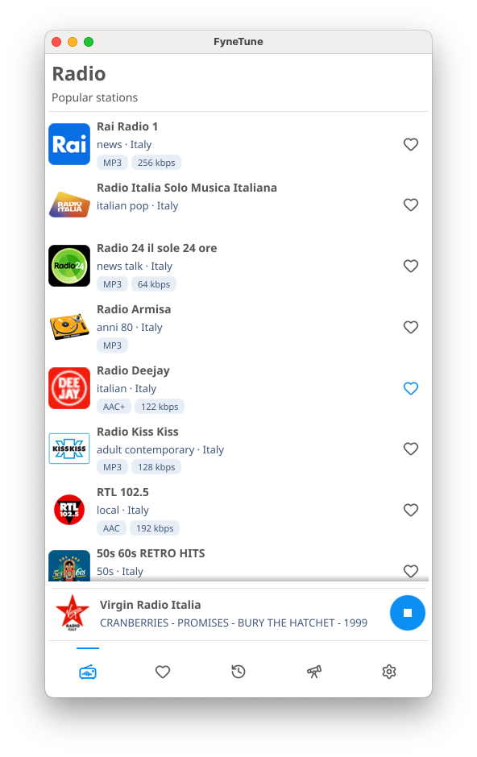

# FyneTune

<p align="center">
  
</p>

FyneTune is a lightweight internet radio player for Windows, macOS, Linux, FreeBSD, and Android. Discover stations, save favorites, and listen while the app runs in the background.

<p align="center">
  
</p>

## Features

- Browse and search stations from [Radio Browser](https://www.radio-browser.info/).
- Save favorite stations, revisit recently played stations, or add a custom stream.
- Listen to a wide range of radio stations with volume control and automatic reconnection.
- Add stations from stream links and playlist files.
- Show artist and track information when a station provides ICY metadata.
- Keep listening from the system tray on supported desktops.
- Save stations and preferences between launches.

## Installation

Download the latest packages from the [Releases page](https://github.com/lucor/fynetune/releases/latest). Packages are available for Linux (amd64 and arm64), macOS (Intel and Apple Silicon), Windows (amd64), FreeBSD (amd64 and arm64), and Android.

### Linux

Download the `.tar.xz` package for your architecture and extract it. From the extracted directory containing the `Makefile`, run `make user-install` to install FyneTune for your user, or `sudo make install` to install it system-wide.

### macOS

Install FyneTune with Homebrew using the [Lucor tap](https://github.com/lucor/homebrew-tap):

```sh
brew install --cask lucor/tap/fynetune
```

Alternatively, download the `.dmg` package from the [Releases page](https://github.com/lucor/fynetune/releases/latest): `darwin_amd64` for Intel or `darwin_arm64` for Apple Silicon. Open the disk image and drag FyneTune to Applications.

FyneTune is not notarized. After installing with either method, remove the quarantine attribute to allow macOS to open the app:

```sh
xattr -r -d com.apple.quarantine /Applications/FyneTune.app
```

Run this command again after upgrading FyneTune.

### Windows

Download and run the `windows_amd64.exe` package.

### FreeBSD

Download and extract the `.tar.xz` package for your architecture. Install GNU Make (`gmake`) if needed, then from the extracted directory containing the `Makefile`, run `gmake user-install` to install FyneTune for your user, or `sudo gmake install` to install it system-wide.

### Android

Download the `.apk` package to your Android device and open it to start installation. Because the APK is distributed outside Google Play, Android requires explicit permission for the browser or file manager opening it to [install unknown apps](https://developer.android.com/distribute/marketing-tools/alternative-distribution). This protects against unwanted installations from other sources. Follow the installation prompt to enable **Allow from this source** for that app, then return to the APK and complete installation. You can disable this permission afterward; FyneTune will continue to work.

## Development

FyneTune is written in Go and uses [Fyne](https://fyne.io/) for its desktop and Android interfaces. [mise](https://mise.jdx.dev/) manages the Go toolchain and project tasks. Install the platform prerequisites below, then set up dependencies and run the app:

```sh
mise install
mise setup
mise start
```

Project tasks are available through mise:

- `mise run build` builds the desktop binary to `dist/fynetune`.
- `mise run licenses` manually generates `THIRD_PARTY_LICENSES` from Go module dependencies.
- `mise run package` creates a package for the current desktop platform.
- `mise run package-android` builds an Android APK.
- `mise run check` runs formatting, static analysis, vulnerability checks, tests, and a build.
- `mise run test-race` runs tests with Go's race detector.

### Platform prerequisites

To compile FyneTune for your target platform, install the prerequisites listed by
[Fyne](https://docs.fyne.io/started/) and [Oto](https://github.com/ebitengine/oto).
Requirements vary by operating system and target architecture, so follow both projects' platform-specific setup guidance.

## License

FyneTune is licensed under the [MIT License](LICENSE).
